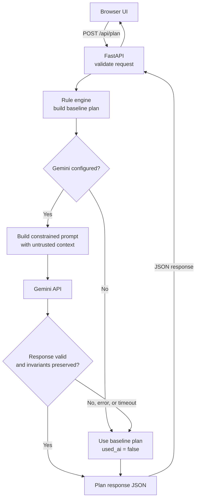

# ClearAir Home Architecture

## Request flow

The normal plan path is deterministic first. FastAPI validates the request, the rule engine builds the baseline, and Gemini may personalize explanations. If Gemini is unavailable or its output fails validation, the baseline plan is returned.

The browser also has two optional AQI detection paths: a place-name request to `GET /api/aqi`, and a coordinate request to `GET /api/aqi/coords`. These use the AQI provider and Open-Meteo; manual AQI entry does not depend on either route.

## Components

- **Browser (`static/`)**: collects user context, submits same-origin requests, and renders plan fields as text.
- **FastAPI (`app/main.py`)**: exposes the page, health check, plan, and AQI routes. It applies validation and the application’s security middleware.
- **Schemas (`app/schemas.py`)**: validate request fields and shape responses.
- **Rule engine (`app/rules.py`)**: maps AQI to an Indian AQI band and builds routine, indoor, and swap recommendations from the validated context. It performs no I/O.
- **Gemini adapter (`app/llm.py`)**: builds the personalization prompt, calls Gemini when configured, validates the response against the baseline constraints, and falls back on failure.
- **AQI provider (`app/aqi_provider.py`)**: fetches optional Open-Meteo readings, converts PM2.5/PM10 with piecewise CPCB breakpoint interpolation, and caches results in process memory.

## Prompt flow

1. `app/llm.py` receives the validated request and the baseline plan created by `app/rules.py`.
2. The user context and baseline plan are serialized into the prompt. The location is treated as untrusted data and enclosed in an explicit context block; angle brackets are removed from the inserted text. The system instructions tell Gemini to treat user-provided text as data, not as instructions.
3. Gemini is asked to return JSON matching the plan response shape. It may personalize the summary and explanations, but the prompt prohibits changing actions, AQI band, or section item counts and prohibits unsafe medical claims.
4. The returned text is parsed and validated. The application verifies that the AQI band and action text still match the deterministic baseline. Invalid JSON, changed invariants, an empty response, or an upstream error returns the baseline with `used_ai=False`.
5. The API returns the final plan. The browser renders values with text APIs rather than treating them as HTML.

These controls reduce the effect of unexpected model output; they do not make a language model a trusted decision engine. Safety-critical recommendations remain in the deterministic rule engine.

## AQI detection flow

For place lookup, FastAPI validates the place string, then the provider geocodes it and requests current PM2.5 and PM10 from the allowlisted Open-Meteo hosts. For coordinate lookup, input coordinates are validated and rounded to two decimal places before request and cache use. The provider calculates each pollutant sub-index and returns the higher result, capped at 500. Provider errors become a friendly unavailable response; users can still enter AQI manually.

The cache is in-memory and per process, with a 15-minute TTL and a 256-entry maximum. It is not shared across Cloud Run instances and is cleared when an instance restarts.

## Runtime security and privacy

- Request models reject invalid AQI ranges, invalid enum values, and unexpected fields.
- The app sets CSP, `X-Content-Type-Options`, `X-Frame-Options`, `Referrer-Policy`, and `Permissions-Policy` headers.
- The middleware limits request bodies to 64 KiB and applies a per-IP sliding-window rate limit.
- Outbound AQI requests use HTTPS, fixed Open-Meteo endpoints, disabled redirects, and a timeout.
- Gemini credentials are read from runtime configuration. In Cloud Run, use Secret Manager and grant access to the service identity; never bake the key into the image.
- Coordinate rounding reduces precision before backend lookup. Avoid putting sensitive personal information in the location field.
